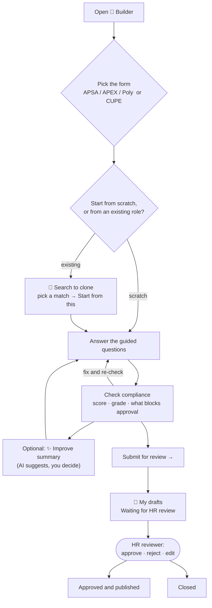

# The JD Builder: a guide for managers

*For a manager who will walk their staff through writing job descriptions in the JD Bank.*
*Checked against the live rulebook on 2026-10-15. If the Builder disagrees with this page,
the Builder is right, because it reads the rules directly.*

---

## In one paragraph

The JD Builder is the page in the JD Bank where you write a new job description. It asks
guided questions, assembles your answers into SFU's official form, and checks the draft
against SFU's job-description standards while you write. When you're done you submit it.
**Nothing you write is ever published automatically.** Every job description goes to an HR
reviewer, and only they can approve it.

---

## 1. The process, start to finish

**Step by step:**

1. **Open 🧱 Builder** from the menu bar. Anyone who can sign in with their SFU computing
   ID can author.
2. **Pick the form** for the job's employee group (see §2). **Switching forms later starts
   a fresh draft**, because the two forms ask different questions and answers can't carry
   across. So pick the right one first.
3. **Start from something that already exists when you can.** *Search to clone* finds
   SFU's existing harmonized roles and archive job descriptions. Starting from one of those
   is usually faster and more consistent than starting from a blank page.
   - The **"Roles SFU already has"** panel appears once you've written enough. It lists
     existing roles that look like the one you're writing, plus how many roles already use
     your exact title and in how many departments. If one fits, clone it instead of creating
     a duplicate. The panel is advisory only. It never blocks you, and it deliberately shows
     no similarity percentage.
   - ⚠ *Search to clone currently finds APSA/APEX/Poly roles only.* A CUPE author won't
     see CUPE results yet.
4. **Answer the guided questions.** Each one has a hint that explains what SFU expects.
5. **Click *Check compliance*** as often as you like. The panel shows:
   - a **score** out of 100 and a **grade** from A to F,
   - **what blocks approval**, if anything,
   - **"Still to write"**: the sections that are missing,
   - your findings, each linked to the section it concerns. While something still blocks
     approval they're headed **"Fix these"**. Once nothing blocks, the rest become amber
     **"Suggested improvements"**, which are worth doing but won't stop the review.
6. **Optional: *✨ Improve summary*.** SFU's own self-hosted AI model suggests a rewording
   of the Position Summary, and the Builder re-checks the suggestion. **You decide whether
   to use it.** Nothing is applied automatically, and no job description text is sent to
   an outside AI service.
7. **Optional: *Export .docx*** downloads the official SFU Word document. Exporting
   doesn't check, submit or publish anything.
8. **Click *Submit for review →*.** The draft goes to the HR review queue under your
   name, and you land on **📝 My drafts**.
9. **Track it in 📝 My drafts.** You'll see one of three statuses:
   - **Waiting for HR review**
   - **Approved and published**
   - **Closed**: either rejected, or replaced by a newer version of the same role. The
     system records both the same way, so it doesn't guess which.

   The score on *My drafts* is the one from when you submitted. HR re-runs the check
   before approving.

**What HR does with it:** the reviewer reads the draft, re-runs the checks, and then
**approves**, **rejects** (with a reason) or **edits** it. Every action is recorded in an
audit log that can't be altered. If an approved job description is later edited, the
approved version stays live until its replacement is approved too.

---

## 2. The two forms: APSA/APEX/Poly vs CUPE

SFU writes job descriptions on **two different documents**, and the Builder treats them as
two different forms, not as one form with variations. The form is determined by the
position's employee group.

| | **APSA / APEX / Poly** (shown as *"JDFN"* in the Builder) | **CUPE 3338** (shown as *"CUPE (WJQ)"*) |
|---|---|---|
| **What it is** | SFU's standard job-description template, the one the SFU JD Toolkit describes | The **Weighted Job Questionnaire**: a 14-section point-factor questionnaire used to evaluate the job |
| **Duties** | **3 to 5** primary functions, most important first | **Major functions** (the form prints **12** slots), plus optional **minor or occasional functions** |
| **Time percentages on duties** | **Required.** Each duty gets a percentage, and they must total 100% | Requested "where you can". **Not checked** |
| **Impact of Decision Making** | Asked (what decisions the role owns) | **Not on the form** |
| **Problem Solving** | Asked (what problems it resolves, how independently) | **Not on the form** |
| **Point-factor questions** | Not on the form | **Asked:** Level of Independence, Training given to others, Direction/supervision exercised, Impact of Errors, Effort (physical/mental), Working Conditions, Continuing Education |
| **Relationships** | Supervises whom; internal and external contacts | Internal contacts; external contacts |
| **Qualifications** | Minimum education and experience; Knowledge → Skills → Abilities | Same structure |
| **SFU boilerplate** (About SFU, territorial acknowledgement, employment-equity statement) | **Required.** One checkbox includes the standard text | **Not on the form**, so not checked (see the open question below) |
| **Position Summary** | 100–150 words, one paragraph | 100–150 words; purpose first, then scope |
| **Identification** | Title, department, employee group, grade (if known) | Title, department, position number, classification and grade |

**Things to tell your staff about the difference:**

- **A CUPE score and an APSA score aren't comparable.** Each form is checked against its
  own rules. A CUPE draft is never marked down for lacking a section the CUPE form doesn't
  have. The system never blends the two into one number, so don't compare them across teams.
- **You can't change a draft's form by changing its employee group.** If you set the group
  to CUPE while on the APSA form, the Builder stops and tells you to start on the CUPE form.
  This exists because the same text scores very differently under the two rule sets.
- ⚠ **The CUPE rules are provisional.** SFU's JD Toolkit doesn't cover the CUPE
  questionnaire, so each CUPE setting was set by the project team after measuring SFU's
  existing CUPE job descriptions. HR hasn't ruled on them yet. Two open questions matter
  most:
  - whether the JD Bank should be used to author CUPE job descriptions at all;
  - whether CUPE job descriptions must carry SFU's boilerplate statements.

---

## 3. The compliance check, in plain terms

### How the score works

- Every draft **starts at 100**.
- Each problem found costs points by severity: **high −20, medium −10, low −5**.
  Informational notes cost nothing.
- Repeats of the same severity cost progressively less. Each extra one is worth 70% of
  the one before, so one bad habit repeated ten times doesn't zero the score.
- **Grades:** A = 90+, B = 75+, C = 60+, D = 40+, F = below 40.

### The approval line

A draft can be approved only when **all** of the following hold:

- the score is **at least 60**,
- the grade is **at least C**,
- **no high-severity problem** is outstanding,
- **none of the specific "never approve" checks below** has failed.

An HR reviewer may **waive** most failed checks, but only with a **written reason**, which
is recorded permanently. **Two can never be waived**, marked 🔒 below.

### The "never approve" checks

| Check | What the author must do | Applies to |
|---|---|---|
| 🔒 **Mandatory sections present** | Include a Position Summary, Duties and Qualifications | Both forms |
| 🔒 **No leftover template text** | Replace all instructional or placeholder text from the template | Both forms |
| **Duty percentages total 100%** | Give each duty a share of time, adding up to 100% | APSA/APEX/Poly only |
| **Qualifications state the minimum** | No "assets", "preferences" or "may include". State what's required, not what's nice to have | Both forms |
| **Footer statements present** | Include the territorial acknowledgement and the employment-equity statement (the boilerplate checkbox) | APSA/APEX/Poly only |
| **Summary describes the role's purpose** | Keep working conditions out of the Position Summary | Both forms |
| **Describe the position, not the person** | No "I", and nothing tied to the current incumbent | Both forms |
| **Summary not too long** | 150 words maximum | Both forms |
| **Knowledge → Skills → Abilities order** | List the qualifications in that order | Both forms |
| **An "equivalent combination" path** | Say that an equivalent combination of education and experience is acceptable, so equally qualified people aren't excluded | Both forms |
| **"Senior" titles need supervisory scope** | Only use "Senior" if the role supervises others | Both forms |

### Other standards that affect the score (but don't block on their own)

| Standard | Guidance | Applies to |
|---|---|---|
| **Position Summary length** | At least 100 words (150 maximum is a blocking check above) | Both |
| **Number of duties** | APSA: 3–5. CUPE: 3–12 | Each form's own range |
| **Duties start with an action verb** | Use SFU's approved action verbs ("Coordinates…", "Develops…") | Both |
| **Duties say how and why** | Not just *what* is done, but how and to what end | Both |
| **No coded or gendered language** | The Builder suggests a neutral alternative, e.g. "chairman" → "chair", "manpower" → "workforce", "rockstar" → "skilled", "aggressive" → "rapid" | Both |
| **Skills carry a proficiency level** | Basic / intermediate / advanced / expert | Both |
| **Knowledge uses the Toolkit wording** | e.g. "working knowledge of…", "excellent knowledge of…" | Both |
| **Degrees name a discipline** | …and allow related fields | Both |
| **Abilities are observable** | Describe something you could see someone do | Both |
| **Reserved titles** | "Executive Director" is for APEX; "Registrar" and "Human Resources" are reserved for those units | Both |
| **Impact of Decision Making / Problem Solving sections** | Fill them in | APSA/APEX/Poly only |
| **About SFU paragraph; standard Relationships header** | Included via the boilerplate checkbox / form | APSA/APEX/Poly only |

### ⚠ These are defaults, not final HR policy

Nearly every number on this page is a **default the project team set**, recorded in the HR
decision register for SFU HR to rule on. That includes the score floor of 60, the grade
floor of C, the duty ranges, the severity levels and which checks block approval. Two have
been ratified so far: the "equivalent combination" wording and the
Knowledge → Skills → Abilities order. When HR changes a value, the Builder picks it up
directly. **Treat today's thresholds as the current bar, not a permanent one.**

---

## 4. Talking points for your staff

1. **It's a writing aid, not an approval.** A green panel means "ready for HR to look at",
   not "approved". Only an HR reviewer publishes.
2. **Search before you write.** If SFU already has the role, clone it. The "Roles SFU
   already has" panel exists to prevent near-duplicate job descriptions.
3. **Pick the right form first.** APSA, APEX and Polyparty roles use the standard form.
   CUPE 3338 roles use the Weighted Job Questionnaire. Switching later means starting over.
4. **Describe the job, not the person in it.** This is the most common reason a summary
   gets flagged.
5. **State the minimum.** Qualifications are the minimum to do the job, with an
   "equivalent combination" path. Leave out "assets" and "preferences".
6. **The AI only suggests.** The summary assist is optional, runs on SFU's own
   infrastructure, and never changes your draft unless you accept its suggestion.
7. **Follow up in 📝 My drafts.** That's where you see what HR decided.
