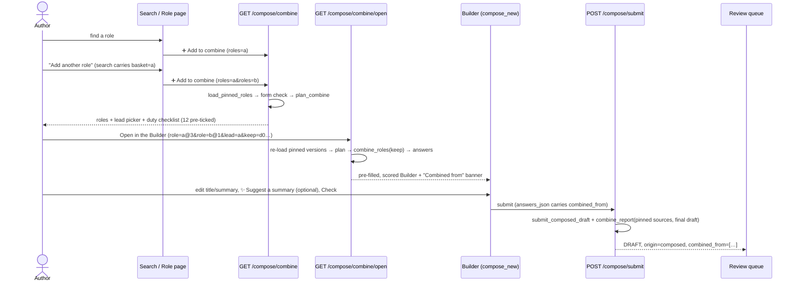

# Track H — Combine harmonized roles: detailed design, flows, and slice plans (H0–H4)

**Design only. Nothing here is built.** Companion to
[`BUILDER-COMBINE-ROLES.md`](BUILDER-COMBINE-ROLES.md), which holds the *why* and the
director's rulings. This document holds the *how*: data model, engine algorithm, config,
routes, screens, lineage, tests, and a step-by-step plan for each slice.

Written 2026-10-15 against the tree at `5ab29af`. Every function, file and route named as
existing was read in the tree that day. Anything not yet verified is marked **⚠ verify
in Hn**, and the slice that owns it must settle it before writing code that depends on it.

---

## 0. Scope, rulings, and the invariants that bind

### Director's rulings (2026-10-15), and what each one means for the build

| # | Ruling | Consequence in this design |
|---|---|---|
| 1 | A combined role does **not** replace its sources | Nothing in Track H writes to a source role. No supersede, no archive, no status change. Tests assert source rows are byte-identical before and after (§11). |
| 2 | **Roles only** | Only `canonical_jds`-backed roles (clusters) can be added. No `source_document_id` route, no archive-document button. |
| 3 | **CUPE and APSA don't combine** | A selection spanning two forms is **refused** with an explanation (§7.3, state S4). JDFN+JDFN and WJQ+WJQ are both in scope. |
| 4 | **No LLM in the combine; only on the final draft** | `combine_roles` is pure and deterministic, and never imports an LLM client. On the final draft the author can use the existing **✨ Suggest a summary** (`/compose/assist`, author-triggered, validator-checked). No new LLM call is added anywhere. |

### Invariants this track must not break

| Invariant | How Track H honours it |
|---|---|
| NN #1: nothing auto-publishes | The output is a Builder page. Persisting is the existing `submit_composed_draft` → DRAFT → review queue. |
| NN #2: rulebook as data | Every policy is in `harmonization.yaml` under `combine:` and registered `open` (§5). |
| NN #3: the validator is the oracle | Tests assert validator post-state and structural properties, never model text (no model is involved anyway). |
| NN #6: provenance | Lineage is pinned to `(cluster_id, version)`. The reviewer gets a report computed from the pinned sources against the **final** draft (§8). |
| `merge_cluster` is order-invariant | Not touched semantically. Shared helpers are extracted in a byte-identical refactor, proven by the existing merge tests (H1 step 1). |
| Form scoping (HR-225) | The basket is scoped to one form. Search keeps scoping by the basket's form. |
| Directive #0 / #1 | Each slice ships through a PR with `make gates` green and `make smoke` green. H4 extends smoke to cover the feature (§12.H4). No new dependency, no migration, so the offline bundle is untouched (⚠ verify in H3: lineage lives in existing JSONB columns). |

### Out of scope (explicitly)

- Retiring or superseding source roles (ruling 1).
- Combining archive documents or singletons (ruling 2).
- Cross-form combining (ruling 3).
- Any LLM blending of duties or sections (ruling 4).
- Duty %-allocation rebalancing. Allocations are cleared and the author sets them (§4.5).
- A JavaScript basket or tray widget. The Builder has no JS, and this track adds none.

---

## 1. Architecture

```
 core/src/jd_core/  (pure: no I/O, imports no jd_bank — the layering ratchet)
 ├─ bank/merge.py          shared helpers extracted (H1, byte-identical refactor)
 ├─ bank/combine.py        NEW  plan_combine(), combine_roles(), combine_report()
 ├─ models/bank.py         NEW  DutyCandidate, CombinePlan, CombinedRole,
 │                              CombineProvenance, CombineReport (+ row models)
 └─ rules/harmonization.yaml + loader.py   NEW `combine:` block, CombinePolicy model

 core/src/jd_bank/composer/  (service: DB, forms)
 ├─ combine.py             NEW  RoleRef, load_pinned_roles(), CombineSelection,
 │                              build_combined_answers()
 ├─ answers.py             AnswerContract gains `combined_from: tuple[RoleRef, ...]`
 ├─ forms.py               render_kind: AnswerContract fields are lineage → hidden
 ├─ duplicates.py          exclude_cluster_id → exclude_cluster_ids (a set)
 └─ persist.py             submit_composed_draft(..., combined_from=...)

 core/src/api/
 ├─ routes/compose_ui.py   NEW GET /compose/combine, GET /compose/combine/open;
 │                         search carries `basket`; Builder banner context
 ├─ routes/ui.py           review detail reads change_log["combine_report"]
 └─ templates/             NEW compose_combine.html; edits to compose_search.html,
                           role_detail.html, compose_new.html, review_detail.html

 core/src/jd_bank/combine_measure/   NEW (H0) read-only measurement runner
```

The pure engine knows nothing about cluster ids or versions. It takes JDs **in author
order, lead first**, and returns drafts plus index-based provenance. The service layer
maps indices back to `RoleRef`s. That is the same split `merge_cluster` and the canonical
producer already use.

---

## 2. End-to-end flow



Every step before Submit is a **GET and read-only**. Nothing is persisted until the
author submits, which is the same behaviour as today's clone (`_render_clone`).

---

## 3. Data model

### 3.1 Service layer (`jd_bank/composer/combine.py`, `answers.py`)

```python
class RoleRef(BaseModel):
    """One source role, pinned to the version that was combined."""
    model_config = ConfigDict(extra="forbid", frozen=True)
    cluster_id: UUID
    version: int = Field(ge=1)

class AnswerContract(BaseModel):          # existing class, one additive field
    cloned_from_cluster_id: UUID | None = None
    #: The roles this draft was COMBINED from, lead first. Empty = not a combine.
    #: Additive + defaulted, so every stored answers_json still validates.
    combined_from: tuple[RoleRef, ...] = ()

    # model_validator: cloned_from_cluster_id and combined_from are mutually exclusive.
```

**Why the version is pinned.** A reviewer can edit a role between the combine page
loading and the author pressing *Open*. That mints a new version and shifts the duty list.
Positional duty keys (`d0`, `d1`, …) are only stable over fixed content. Pinning makes
them stable and makes the lineage exact (NN #6).

⚠ **Verify in H1:** that `canonical_jds.content` is never updated in place for an
existing `(cluster_id, version)`. CLAUDE.md says a reviewer edit "mints a new DRAFT". The
code must agree: grep for every write to `CanonicalJD.content`. If any in-place write
exists, the pinning argument fails and the keys must become content hashes instead.

### 3.2 Engine (`jd_core/models/bank.py`)

```python
DutyKey = Annotated[str, StringConstraints(pattern=r"^d\d{1,3}$")]

class DutyCandidate(BaseModel):         # frozen
    key: DutyKey                        # position in plan order: "d0", "d1", …
    duty: SFUDuty                       # the representative, verbatim
    roles: tuple[int, ...]              # which input roles carry it (author order)
    folded: tuple[tuple[int, str], ...] # (role_index, statement) that folded onto it
    default_kept: bool                  # pre-ticked on the combine page

class CombinePlan(BaseModel):           # frozen; what the combine page renders
    role_count: int
    template: JDTemplate                # the one shared form
    duty_capacity: int                  # read off the target form's model (§4.4)
    candidates: tuple[DutyCandidate, ...]
    flags: tuple[str, ...]              # §4.7

class CombineProvenance(BaseModel):     # frozen; mirrors MergeProvenance's shape
    role_count: int
    lead_index: int = 0
    section_contributors: tuple[tuple[str, tuple[int, ...]], ...]
    kept_duty_keys: tuple[DutyKey, ...]
    left_out: tuple[LeftOut, ...]       # (role_index, section, text, reason)
    seniority_bars: tuple[SeniorityBarChoice, ...]
    flags: tuple[str, ...]

class CombinedRole(BaseModel):          # frozen
    draft: SFUJobDescription            # a DRAFT, never canonical
    provenance: CombineProvenance

LeftOutReason = Literal[
    "not_ticked",          # the author unticked it on the combine page
    "lead_only_section",   # policy took this section from the lead role only
    "over_model_cap",      # a union exceeded the SFUJobDescription list cap
]
```

### 3.3 Report for the reviewer (`CombineReport`, computed at submit)

```python
LineFate = Literal["verbatim", "reworded", "absent"]

class SourceLine(BaseModel):            # one source role's duty / qualification line
    role_index: int
    section: Literal["duties", "qualifications", "decision_making",
                     "problem_solving"]
    text: str
    fate: LineFate                      # vs the FINAL draft

class FinalLine(BaseModel):             # one line of the final draft
    section: str
    text: str
    origin: Literal["inherited", "reworded", "new"]   # new = no source line matches
    from_roles: tuple[int, ...]

class CombineReport(BaseModel):
    sources: tuple[RoleRef-as-dict, ...]   # serialized at the service layer
    source_lines: tuple[SourceLine, ...]
    final_lines: tuple[FinalLine, ...]
    flags: tuple[str, ...]
```

**The report is computed against the *final* draft, not the combine output.** The author
edits freely after combining, so a record of what the combine produced would describe a
draft nobody is approving. What the reviewer needs is: *for each source line, is it in
what I am approving, and for each line I am approving, where did it come from?* "Reworded"
uses the same token-Jaccard at `duty_dedup_jaccard_min` (HR-171, one home). It is a
**match**, not a score, and the report shows no percentage (see memory: role similarity
has no threshold).

---

## 4. The engine (`jd_core/bank/combine.py`)

### 4.1 API

```python
def plan_combine(roles: Sequence[SFUJobDescription], *,
                 rules: Rules | None = None) -> CombinePlan
def combine_roles(roles: Sequence[SFUJobDescription], *,
                  keep: Collection[DutyKey] | None = None,   # None = the default ticks
                  rules: Rules | None = None) -> CombinedRole
def combine_report(roles: Sequence[SFUJobDescription], final: SFUJobDescription, *,
                   rules: Rules | None = None) -> CombineReport
```

- `roles[0]` is the **lead**. The caller orders them. The engine has no `lead` parameter,
  so it cannot disagree with the order it is given.
- **Deterministic, deliberately NOT order-invariant.** The same sequence gives a
  byte-identical result, and a different order gives a different result *by design*.
  The docstring must say so in words, because `merge_cluster` sits next to it with the
  opposite guarantee.
- **Raises `ValueError`** on: fewer than 2 roles, more than `combine.max_roles`, or roles
  on more than one form (`template_of`). The service layer checks the same things first
  and renders a page. The engine raising is the backstop.
- `combine_roles(keep=k)` calls `plan_combine` internally, so the keys always refer to
  the plan the engine itself computed. An unknown key raises `ValueError`.

### 4.2 Effective policy: an overlay, like `harmonization_for`

The section helpers in `merge.py` read a `Harmonization`. The engine builds one with the
`combine:` values laid over the form's harmonization profile:

```python
base = rules.harmonization_for(template)          # existing JDFN/WJQ overlay
eff  = base.model_copy(update={
    "core_skill_min_fraction": 0.0 if c.skill_policy == "union"
                               else base.core_skill_min_fraction,
    "seniority_bar_policy":   c.seniority_bar_policy,
    "decision_making_policy": c.decision_making_policy,
    "problem_solving_policy": c.problem_solving_policy,
    "relationships_policy":   c.relationships_policy,
    "security_policy":        c.security_policy,
})
```

`duty_dedup_jaccard_min` (HR-171) and the qualification grouping are **reused, not
copied**. If H0 shows combining needs a different fold threshold, it becomes its own
registered knob then. Until then a second copy would be a second home for the same fact.

### 4.3 Section by section

| Section | Algorithm | Reuses |
|---|---|---|
| `title` | `lead`: `roles[0].title`, flag `title_from_lead`. `blank`: `""` (the Builder then shows the title as missing). | — |
| `department` | lead role's | — |
| `employee_group` | all equal → carry it. Any difference → `None` + flag `employee_group_disagreement`. (Same form guaranteed, so this is APSA vs APEX vs Poly within JDFN.) | `_modal_non_null_flagged` for the disagreement test |
| `grade` | `blank` → `None` + flag `grade_withheld`. `lead` → lead's. | — |
| `position_summary` | `lead` → lead's verbatim + flag `summary_from_lead`. `blank` → `None`. | — |
| `duties` | §4.4 | the greedy grouping extracted from `_resolve_duty_groups` |
| `decision_making`, `problem_solving` | under `eff` policy (`union` default) | `_merge_statement_section` |
| `relationships` | under `eff` policy (`union`: contact lists pooled by exact casefold, `supervisory` from one role verbatim, as HR-212 documents) | `_merge_relationships` |
| qualifications | `_rebuild_ksa(ordered, sigs, eff_rules, eff)`; with `core_skill_min_fraction = 0` every skill-bearing qualification is core, so this is a deduped union | `_rebuild_ksa` |
| education / experience bar | inside `_rebuild_ksa`, `seniority_bar_policy` (`max` default) | `_seniority_qual` |
| security | `union` | `_security_quals` |
| boilerplate booleans | `True` (a combine starts a new compliant JD; `_render_clone` forces it on anyway for JDFN) | — |
| `additional_context` | `lead` → lead's verbatim. On the **WJQ** this is where the seven point-factor sections live, and they rate one position, so pooling them would state factor levels no source wrote. | — |
| `position_number` | never carried (a new role has none) | — |

⚠ **Verify in H1: does a union of qualifications lose anything?** `_rebuild_ksa` only
considers kinds in `comparison.skill_source_kinds` (`skill, knowledge, ability`) plus
education, experience and security, and keeps only quals with at least one skill token.
A qualification of any other kind, or one made only of stopwords, would vanish without a
`left_out` record. The conservation test (§11.1) will catch it. The fix is to route
those through `left_out` or a pass-through, **not** to weaken the test.

⚠ **Verify in H1: list caps.** `_rebuild_ksa` truncates to 40 and the statement unions
truncate to the model cap. Two or more roles can exceed them more easily than one
cluster. Anything truncated must land in `left_out` with `over_model_cap`.

### 4.4 Duties: grouping, order, capacity, default ticks

1. **Occurrences in author order:** `[(r, i, duty) for r, role in enumerate(roles) for i,
   duty in enumerate(role.duties)]`. Each role's own duty order is preserved. A
   harmonized role's duties are already ordered by member coverage, so that order means
   something.
2. **Greedy grouping** at `duty_dedup_jaccard_min`, iterating in that order. This uses
   the grouping loop extracted from `_resolve_duty_groups` (H1 step 1), *not* its
   alphabetical pre-sort. The representative is the richest `how_why`, then the longest
   statement: the same rule as the merge.
3. **Plan order:**
   1. groups covering ≥ 2 roles, by coverage descending, then by first occurrence;
   2. then single-role groups, by role (lead first), then by position within that role.
4. **Keys** `d0…dN` are assigned in plan order.
5. **Capacity** is read off the target form's answer model with the `_model_list_cap`
   pattern, never restated as a literal. JDFN `ComposerAnswers.duties` caps at 12. ⚠
   **Verify in H1 for the WJQ**: `WJQAnswers` has `major_functions` (12) and
   `minor_functions` (12). How does `clone_from_jd` split `SFUJobDescription.duties`
   between them, and what does `SFUJobDescription.duties` itself cap at? The capacity
   is whatever round-trips through `clone_from_jd` → `assemble_checked` with no loss,
   pinned by a test, not by reading.
6. **Default ticks:** the first `duty_capacity` candidates in plan order. This is
   mechanical (it is the model's own limit), so it is **not** a knob.
7. Flag `duties_over_capacity` when `len(candidates) > duty_capacity`.

### 4.5 Allocations

Two roles' `(NN%)` allocations add up to about 200%, so carrying them over would fail
the allocation gate on every combine. They are cleared **at the answers layer**
(`DutyAnswer.allocation = None` after `clone_from_jd`), and flag `allocations_cleared` is
raised if any were non-null.

⚠ **Verify in H2:** where the percentage actually lives after a round-trip. If
`jd_to_answers` parses `(NN%)` out of the statement, clearing at the answers layer is
enough. If it stays inside `SFUDuty.statement`, it must be stripped in the engine
instead. A test asserts that no combined duty statement still contains `\(\d+%\)`.

### 4.6 The conservation invariant (the property the whole engine is tested against)

> **Every piece of source content is accounted for:** for every source role and every
> line in `duties`, `qualifications`, `decision_making`, `problem_solving`,
> `relationships.internal/external`, the line is **in the draft verbatim**, **folded**
> onto a representative that is in the draft, or listed in `provenance.left_out` with a
> reason.

This is the combine's version of "nothing vanishes silently". It is a property test over
generated inputs *and* a live smoke assertion over real roles (H4).

### 4.7 Flags (descriptive, never auto-fixes)

`title_from_lead`, `summary_from_lead`, `employee_group_disagreement`, `grade_withheld`,
`duties_over_capacity`, `allocations_cleared` (service layer), `content_left_out` (any
`left_out` entry other than `not_ticked`).

---

## 5. Configuration and the register

### 5.1 YAML: a nested block in `harmonization.yaml`

```yaml
# --- combining DIFFERENT roles into a new one (Track H) ------------------------------
# The OPPOSITE intent to everything above: harmonizing keeps what variants of ONE role
# agree on; combining keeps the union of what DIFFERENT roles cover. Each value below
# is our_invention, status open. See docs/plans/BUILDER-COMBINE-ROLES*.md.
combine:
  max_roles: 4
  title_policy: lead               # lead | blank
  summary_policy: lead             # lead | blank
  skill_policy: union              # union | core_only (core_only = HR-173 behaviour)
  seniority_bar_policy: max        # max | modal (HR-175's options)
  decision_making_policy: union    # drop | longest | union (HR-210's options)
  problem_solving_policy: union    # drop | longest | union
  relationships_policy: union      # drop | longest | union (≠ HR-212's `longest`)
  security_policy: union           # union | core_only
  grade_policy: blank              # blank | lead
  additional_context_policy: lead  # lead | drop  (on the WJQ: the point-factor sections)
```

**Why nested here and not a new rule file.** A new file costs six wiring points and
trips three closed-world guards (see memory: adding a rules YAML). A nested model
follows the existing `wjq:` precedent (`TemplateHarmonization`): required, no default,
`extra="forbid"`, and each field lands on the decision surface as
`harmonization.combine.<field>` the moment it is declared. `harmonization.yaml` is
**unhashed**, which is correct here: these knobs decide how a draft is *assembled*, never
how a JD is *scored*.

**Loader:** `class CombinePolicy(BaseModel)` with `Literal` types reusing the existing
`SectionMergePolicy`, `SeniorityBarPolicy` and `SecurityPolicy`. `Harmonization.combine:
CombinePolicy`, required. ⚠ **Verify in H1:** `harmonization_for(WJQ)` rebuilds the
model from a dump plus the `wjq` overlay. Confirm the nested `combine` survives that
round-trip unchanged (a test).

### 5.2 Register entries (`decision_register.yaml`, same PR as the YAML)

One entry per knob: **11 entries**, all `provenance: our_invention`, `status: open`,
`tier: hr_policy`, except `max_roles` (`tier: technical`; it bounds a page, not a JD's
content). HR numbers are assigned when they are written, by the next free id. The
`why_it_matters` text for each must state the *harmonize vs combine* contrast where the
combine default differs from its harmonization twin (`skill_policy` vs HR-173,
`relationships_policy` vs HR-212, `additional_context_policy` vs HR-169).

Then `make register`, commit `docs/decisions/HR-DECISION-REGISTER.md` in the **same
commit**, and confirm with `make register-check`. `make gates` does not cover this.

---

## 6. Routes

All are UI routes under `/jd-bank/ui/compose`, gated by `require_ui_user`
(`ANY_AUTHENTICATED`), and added to `EXPECTED_ACCESS` in
`tests/unit/test_authorization_matrix.py` (the completeness check fails until they are).

| Method + path | Params | Does | Persists |
|---|---|---|---|
| `GET /compose/combine` | `roles` (repeated cluster id, ≤ `max_roles`), `lead` (optional cluster id) | Resolve each role to its **current** version, check the form, `plan_combine`, render the combine page. | nothing |
| `GET /compose/combine/open` | `role` (repeated `cluster_id@version`), `lead`, `keep` (repeated `dN`) | Load the **pinned** versions, re-plan, `combine_roles(keep)`, build answers, render the Builder via `_render_clone`. | nothing |
| `GET /compose/search` (existing) | + `basket` (repeated cluster id) | Unchanged search, plus a basket bar and a **➕ Add to combine** link on role hits. | nothing |

**Parameters are parsed as normalized strings, never typed path params** (the 8.3a
lesson that `form_from_request` documents: a typed param answers bad input with a raw 422
JSON blob on a page a person is using). Every bad input renders the combine page with a
message:

| Input | Response |
|---|---|
| malformed UUID, unknown cluster, cluster with no canonical | the role is dropped from the basket with a message naming it |
| more than `max_roles` | the first `max_roles` are kept with a message |
| duplicate id | de-duplicated silently (it is the same role) |
| `lead` not in the basket | the first role leads |
| `keep` key not in the plan, or malformed | the combine page re-renders with picks reset and a message |
| more keeps than `duty_capacity` | re-render with a message: "the form holds 12; you ticked 14" |
| a pinned version is no longer current | re-render the combine page **at the current versions**, picks reset, message: "Records Assistant was updated while you were choosing" |

**No CSRF is needed**: both new routes are GET and read-only. The URL stays under about
1 KB (4 × `uuid@version` + ≤ 48 × `keep=dNN`).

---

## 7. Screens and states

### 7.1 Entry points

**Role page** (`role_detail.html`), next to the existing clone link:

```
🧱 Start a new JD from this harmonized role →
➕ Combine this role with others →          (→ /compose/combine?roles=<this>)
```

**Search results** (`compose_search.html`), per **role** hit (archive-document hits get
no button: ruling 2):

```
 Academic Advisor        · Student Services · draft     Read →
                           Start from harmonized role →   ➕ Add to combine
```

**Search with a basket** shows a bar above the results, and the search form carries the
basket in hidden `basket` inputs:

```
┌──────────────────────────────────────────────────────────────────────────┐
│ Combining: Academic Advisor ✕ · Records Assistant ✕     [Back to combine →] │
└──────────────────────────────────────────────────────────────────────────┘
```

Hits already in the basket show "✓ in combine" instead of the button. Hits on the other
form are already excluded by the form scope (HR-225). The basket's form is passed as
`form`.

### 7.2 The combine page (`compose_combine.html`)

```
Combine roles into a new job description                      JDFN (APSA / APEX / POLY)

 Lead role decides the starting title, summary and department. You will rename it.

 ┌ ◉ Lead ───────────────────┐ ┌ ○ Lead ───────────────────┐   ┌─────────────────┐
 │ Academic Advisor           │ │ Records Assistant          │   │ + Add another   │
 │ draft · APSA · 7 duties    │ │ published · APSA · 6 duties│   │   role (search) │
 │ Read →        Remove ✕     │ │ Read →        Remove ✕     │   └─────────────────┘
 └────────────────────────────┘ └────────────────────────────┘

 ⚠ The two roles have 13 duties between them (1 appears in both). The form holds 12.
   Untick the ones the new role will not do.

 Duties — 12 of 12 selected
  In more than one role
   ☑ Maintains accurate student records …          [Academic Advisor] [Records Assistant]
  From Academic Advisor (lead)
   ☑ Advises students on program requirements …
   ☑ …
  From Records Assistant
   ☑ Processes transcript requests …
   ☐ Files and archives paper records …            ← unticked: listed in the report

 Everything else is combined for you: qualifications (all, de-duplicated; the highest
 education and experience bar), decision making, problem solving and contacts.
 Grade is left blank: it is a classification decision.

                                                   [ Open in the Builder → ]
```

- The form is plain HTML: radio `lead`, checkboxes `keep`, hidden `role=cid@ver`. *Open*
  is a GET submit. Changing the lead re-orders the plan, so the lead radio has its own
  small **Update** button (GET back to `/compose/combine`). Without JS, a re-plan is a
  page load, and that is acceptable.
- The "12 of 12" counter is computed server-side for the page as rendered. Without JS it
  cannot update live, so over-ticking is caught on *Open* (§6) rather than prevented.
  This is stated in the page copy ("the form holds 12"). It is the honest no-JS behaviour.
- **No similarity percentage** between the roles, anywhere.

### 7.3 States the combine page must render (each one is a route test, H2)

| State | Trigger | Shows | *Open* button |
|---|---|---|---|
| S0 empty | no `roles` | how to start: a search box, carrying the form | hidden |
| S1 one role | 1 valid role | the role, "add at least one more", plus the plain clone link | hidden |
| S2 normal | 2..max, same form, ≤ capacity | as §7.2, all ticked | enabled |
| S3 over capacity | union > capacity | the §7.2 warning, first 12 ticked | enabled |
| S4 mixed form | roles on JDFN and WJQ | "CUPE and APSA/Poly roles use different SFU forms and can't be combined. Remove one." No duty list. | **disabled** |
| S5 too many | > `max_roles` | first `max_roles`, with a message | enabled |
| S6 bad ids | malformed / unknown / no canonical | the rest, with a message per dropped id | per remaining count |
| S7 stale | pinned version superseded (from *Open*) | current versions, picks reset, message | enabled |
| S8 group disagreement | APSA + APEX, etc. | ⚠ "Employee group differs: it will be left blank" | enabled |

### 7.4 The Builder after combining (`compose_new.html`, banner only)

```
┌ Combined from: Academic Advisor (lead, v3) · Records Assistant (v1) ──────────────┐
│ The title, summary and department are the lead role's. Rewrite them to describe     │
│ the new role. ✨ Suggest a summary is below the summary box.                         │
│ Left blank on purpose: grade, duty percentages. 1 duty you unticked is not included. │
└──────────────────────────────────────────────────────────────────────────────────────┘
```

The banner comes from `answers.combined_from` (names resolved at render) and the
provenance flags. It persists across *Check* because `combined_from` rides in a hidden
field (§8.1). The near-duplicate panel excludes every source role (§9).

### 7.5 Review detail (`review_detail.html`, new panel)

```
 Combined from   Academic Advisor v3 (lead) →   Records Assistant v1 →

 Where each line came from                 inherited 15 · reworded 3 · new 2
   Duties
     ✓ Advises students on program requirements …      Academic Advisor
     ✎ Coordinates transcript and records requests …   Records Assistant (reworded)
     ＋ Leads the unit's records digitization project   new: in no source role
 Not in this draft
     Files and archives paper records …                 Records Assistant
```

Read from `change_log["combine_report"]`, parsed tolerantly the way `_provenance_view`
does (a malformed packet degrades to no panel and never 500s the approve page).

---

## 8. Lineage and persistence

### 8.1 Carrying `combined_from` through the Builder

⚠ **A trap found while designing this.** `forms.render_kind` maps any field whose
annotation *contains* `"UUID"` to a single hidden input, and `_answers_from_form` reads a
hidden field as one stripped string. A `tuple[RoleRef, ...]` field would either be
classified wrongly or fail validation on the first *Check*, and the lineage would be lost
silently (the field just comes back empty).

**Design:** make the rule explicit rather than incidental. *A field declared on
`AnswerContract` is lineage, not content.* `render_kind` returns `"hidden"` for exactly
those fields (looked up from `AnswerContract.model_fields`, not by annotation text). Their
hidden value is the field serialized as **JSON** (`TypeAdapter(...).dump_json`), and
the reader parses JSON. For backward compatibility, the reader also accepts the legacy
bare-UUID value for `cloned_from_cluster_id`, so a page rendered before the deploy still
submits.

Test: a combined draft survives **Check → Check → Submit** with `combined_from` intact
(the round-trip is the defect; a single render would not show it).

### 8.2 Submit

`submit_composed_draft(..., combined_from: Sequence[RoleRef] = (), combine_report:
CombineReport | None = None)`:

- Written to `cluster.constraint_metadata`, `change_log` and the audit payload, exactly
  where `cloned_from_cluster_id` is written, and **only when non-empty** (the existing
  rule: an absent key is the statement "not combined").
- `change_log["combine_report"]` holds the report.
- The audit event type stays `canonical_draft.composed`. A combine is a composed draft
  with lineage. A new event type would make every existing audit consumer miss it.
- `origin` stays `composed` and `source_document_ids=[]`, so the funnel keeps counting
  combined drafts exactly as it counts composed ones and never as archive coverage.

The route computes the report: re-load the pinned source versions (immutable, §3.1), run
`combine_report(sources, final_draft)`. ⚠ **Verify in H3:** that `constraint_metadata`
and `change_log` are JSONB with no schema check that rejects a new key, so **no
migration** is needed. If one is needed, the slice grows a migration and the offline
bundle question (Directive #1.2) must be answered in the PR.

---

## 9. The near-duplicate guard

`find_related_roles(..., exclude_cluster_id: UUID | None)` becomes
`exclude_cluster_ids: frozenset[UUID] = frozenset()`. Callers pass
`{answers.cloned_from_cluster_id}` or the set of `combined_from` cluster ids. Semantics
are unchanged: excluded roles appear in neither list but **still count** toward
`same_title_count`, which is the true total.

For a combine, this is the most valuable warning the Builder gives: *"SFU already has a
role like the one you just combined."* It must keep working against every *other* role.
A test covers this: combine A + B, where C is near-identical to the result. C is listed,
A and B are not.

---

## 10. Security and authorization

- Two new GET UI routes, `ANY_AUTHENTICATED`, the same as `clone-role` and `search`.
  They expose nothing beyond what an author can already read on the role pages.
- Input is bounded: at most `max_roles` ids are read, `keep` keys must match `^d\d{1,3}$`
  and be fewer than `duty_capacity + 1`, and everything else is ignored.
- No new write path. Submit is the existing CSRF-protected POST.
- No new egress. No LLM in the combine (ruling 4). The duplicate guard's existing
  embedding call is unchanged.

---

## 11. Test strategy

### 11.1 Engine (unit, pure, `tests/unit/test_bank_combine.py`)

| Test | Asserts |
|---|---|
| refuses < 2, > max, mixed form | `ValueError`, with the form names in the message |
| deterministic | same sequence → byte-identical `model_dump_json()` |
| lead order matters | swap the inputs → title, summary and department follow the new lead |
| **conservation (property test)** | §4.6 over generated roles (hypothesis, if it is already a dev dependency; ⚠ verify in H1; else a seeded fixture matrix) |
| shared duties first | a duty in both roles is `d0` and carries both role indices |
| each role's own duty order is kept | |
| default ticks = capacity | and `duties_over_capacity` iff more candidates |
| `keep` honoured, unticked → `left_out(not_ticked)` | |
| unknown `keep` key → `ValueError` | |
| skills union (vs HR-173) | 3 roles, a skill in 1 → kept (the same input through `merge_cluster` drops it: a contrast test) |
| seniority bar `max` | a master's in 1 of 2 → master's, with the `SeniorityBarChoice` recorded |
| group disagreement → `None` + flag | |
| grade always blank under `blank` | even when the roles agree |
| WJQ: point-factor context from the lead only, others in `left_out(lead_only_section)` | |
| each policy option | one test per non-default option (the register's options must all work) |
| `merge_cluster` unchanged | the existing merge suite passes untouched after the helper extraction (H1 step 1) |

### 11.2 Service, routes, persistence

- `test_composer_combine.py`: pinned loading, staleness detection, form refusal,
  allocations cleared, WJQ round-trip with no loss at capacity.
- `test_compose_ui.py`: every §7.3 state renders 200 (never 422/500), the basket survives
  search, Check → Check → Submit keeps `combined_from`.
- `test_authorization_matrix.py`: the new routes classified.
- `test_composer_duplicates.py`: set exclusion, count still includes excluded roles.
- Integration (testcontainers): submit writes lineage to all three places, writes the
  report, **source roles are byte-identical before and after** (ruling 1), audit row
  present, and no `combined_from` key when not combined.

### 11.3 Live (H4)

See §12.H4. Smoke is read-only, so it **does not** exercise submit. Submit is covered by
the integration tests. The H4 PR must say so in those words.

---

## 12. Slice plans

Each slice is one branch, one PR, failing tests first, the guard broken once to prove it
can go red, `make gates` green, and **`make smoke` green before merge** (Directive #0).
The **Gate** row names the minimum, chosen by what the diff touches.

### H0 — Measure before building

**Goal.** Confirm or change the defaults in §5 with numbers from the live Bank before any
engine or UI exists (see memory: measure before designing scoring features).

**Branch** `feat/h0-combine-measure`. **Size** S–M.

**Deliverables**
- `core/src/jd_bank/combine_measure/` (`__main__.py`, `measure.py`, `models.py`):
  read-only, the `singletons` runner's shape.
- `docker-compose.yml`: a `combine-measure` service under `profiles: ["tools"]`
  (copy of the `singletons` block). ⚠ That file is governed (CLAUDE.md: PR only), which
  this slice is anyway.
- `Makefile`: `combine-measure` target. Output `docs/combine/combine-measure.json` and
  `docs/combine/fold-samples.md`.
- A new section in `docs/FINDINGS.md` with the numbers and the command.

**Population.** The current version per cluster, harmonized origin only (exclude
`composed`), excluding roles with no duties. Split by form (JDFN / WJQ). Scoped to the
current `PARSER_VERSION` and recorded as such.

**Samples** (fixed seed, written into the output):

| Sample | How | Why |
|---|---|---|
| A: nearest pairs | each role + its top-1 neighbour in `jd_role_embeddings`, same form, unordered pairs de-duplicated | the realistic "combine two related roles" case |
| B: random pairs | 2,000 same-form pairs | the unrelated extreme |
| C: random triples | 1,000 | 3-role behaviour, and the HR-173 contrast |
| D: same title family | pairs within one `title_family` (e.g. Advisor I / II) | the near-twin extreme |

**Metrics per sample:** distribution (p50/p90/max) of union duty groups; folds per
combine; % of combines over capacity; % with zero folds; employee-group disagreement;
grade disagreement (both non-null and different); education/experience bar disagreement;
skill-union size; qualification count vs the 40 cap; DM/PS union size vs the model cap.

**Use the real grouping, not a copy.** Fold counting imports the merge's own grouping
(`_resolve_duty_groups` over the pair as an ad-hoc "cluster"). This measures the actual
fold behaviour at HR-171 rather than a re-implementation of it.

**🔴 Validate the probe first** (CURRENT.md: *make the probe reproduce a number the
system already knows*). Run the same grouping over each harmonized cluster's **member
documents** and compare the group count with the stored `merge_provenance.duty_coverage`
length on that cluster's draft. Report agreement as a percentage, restricted to drafts
built at the current parser version. **If agreement is not ~100%, stop and fix the
probe**: until it reproduces the merge, its cross-role numbers mean nothing.

**Human eyeball sample.** `fold-samples.md` lists 40 cross-role pairs that **folded** and
40 **near-misses** (0.5 ≤ J < 0.7), each with both statements in full, for the owner to
judge whether 0.7 is right for *different* roles.

**Exit evidence (in the PR body):** the pasted `make combine-measure` output, probe
agreement %, and a table *default → confirmed / changed + why*. Any change edits §5 of
this document in the same PR.

**Decision gates at the end of H0**

| If H0 shows | Then |
|---|---|
| near-twin pairs (D) fold most duties and random pairs (B) fold almost none | 0.7 is fine, proceed |
| near-misses look like the same duty to a human | register a separate `combine.duty_fold_jaccard_min` in H1 |
| > ~50% of nearest pairs (A) exceed capacity | make the over-capacity message the lead UX element, which it already is |
| qualification union regularly exceeds 40 | design `left_out(over_model_cap)` presentation before H2 |

**Gate:** `make gates-fast` (pure + read-only runner) + `make smoke`.

### H1 — The engine and its policy

**Branch** `feat/h1-combine-engine`. **Size** M.

**Steps (in this order)**
1. **Refactor, byte-identical.** Extract the greedy grouping loop out of
   `_resolve_duty_groups` into a helper that takes pre-ordered items. `merge_cluster`
   keeps its alphabetical pre-sort. **The existing merge and change-log suites must pass
   with zero test edits.** If any merge test needs editing, the refactor is wrong. Commit
   this alone.
2. Answer the H1 ⚠ verifications: content immutability per version (§3.1), the WJQ duty
   capacity (§4.4), qualification loss under union (§4.3), the `harmonization_for`
   round-trip of `combine` (§5.1), and whether hypothesis is available (§11.1). Record
   each answer in the PR body.
3. **Failing tests first** for §11.1, all red.
4. `CombinePolicy` in `loader.py`, the `combine:` block in `harmonization.yaml`, export
   from `rules/__init__.py` if public. Then the 11 register entries, `make register`,
   commit the regenerated register **in the same commit**, then `make register-check`.
5. Models in `jd_core/models/bank.py`, then `jd_core/bank/combine.py` until green.
6. Break one guard on purpose (e.g. let the duty union skip `left_out`) and show the
   conservation test going red. Paste it in the PR body.

**Acceptance:** §11.1 green; merge suite untouched; register check clean; `combine.py`
imports no `jd_bank` (the layering ratchet test proves it).

**Gate:** `make gates-fast` + `make register-check` + `make smoke`.

### H2 — The combine page and the basket

**Branch** `feat/h2-combine-ui`. **Size** M–L.

**Steps**
1. `jd_bank/composer/combine.py`: `RoleRef`, `load_pinned_roles(session, refs)` (one
   query, `(cluster_id, version)` IN …), `resolve_current(session, cluster_ids)`, and
   `build_combined_answers(...)` (engine → `form_for(draft).clone_from_jd` → clear
   allocations → set `combined_from`). Tests first.
2. `AnswerContract.combined_from` + the mutual-exclusion validator + the `render_kind`
   lineage rule + JSON hidden serialization + the legacy bare-UUID reader (§8.1). Test
   first: Check → Check → Submit round-trip.
3. Routes `GET /compose/combine` and `GET /compose/combine/open`, then
   `EXPECTED_ACCESS` rows.
4. Templates: new `compose_combine.html`; `compose_search.html` (basket bar, hidden
   basket inputs, ➕ button on role hits); `role_detail.html` (➕ link);
   `compose_new.html` (banner).
5. One route test per §7.3 state; assert 200 and the key copy, never 422/500.
6. Verify the allocation location (§4.5).

**Acceptance:** an author can go role page → combine → search → add → untick → Open →
Check, and the banner and lineage survive. Every §7.3 state renders.

**Gate:** `make gates` (forms and routes) + `make smoke`. Before merge, click through it
on the dev stack once (`/run` or by hand) and paste screenshots or the page text in the
PR. A route test proves the HTML; only a page load proves the flow.

### H3 — Lineage through submit, the guard, and the review panel

**Branch** `feat/h3-combine-lineage`. **Size** M.

**Steps**
1. Verify JSONB with no migration (§8.2). If wrong, stop and re-plan this slice.
2. `combine_report` tests, then the implementation (pure, in `combine.py`).
3. `submit_composed_draft(..., combined_from, combine_report)`; the submit route
   re-loads the pinned versions and computes the report.
4. `find_related_roles(exclude_cluster_ids=...)` and both call sites.
5. Review detail panel + tolerant parse.
6. Integration tests (§11.2), including **source roles byte-identical** (ruling 1).

**Acceptance:** a combined draft in the review queue shows *Combined from* with links and
the line report. Its audit row and cluster metadata carry the lineage. A plain composed
draft carries no `combined_from` key anywhere.

**Gate:** **full `make gates`** (persistence and real Postgres behaviour) + `make smoke`.

### H4 — Live smoke coverage, the guide, discoverability

**Branch** `feat/h4-combine-smoke`. **Size** S–M.

**Steps**
1. Extend `tests/live/test_smoke_live_bank.py` (read-only):
   - `test_two_live_roles_combine_into_a_draft_the_builder_accepts`: deterministically
     pick two current JDFN harmonized roles with ≥ 3 duties each (for example, lowest
     `cluster_id` pair from the H0 nearest-pairs sample, re-queried live, not hard-coded).
     Run `load_pinned_roles` → `plan_combine` → `combine_roles` → `clone_from_jd` →
     `assemble_checked` → `assess_draft`. Assert conservation, ≤ capacity, lineage set,
     and that the draft assembles under its own form.
   - The same for one **WJQ** pair if the live Bank has ≥ 2 WJQ roles; otherwise skip
     **loudly** with the count.
   - **HTTP leg:** `GET /jd-bank/ui/compose/combine?roles=a&roles=b` and `/open` through
     the real app in-process (httpx `ASGITransport`, with the `require_ui_user`
     dependency overridden to a fixed author) against the live DB. Assert 200, both role
     titles on the page, the banner present. ⚠ Smoke has no HTTP harness today; the
     other live suites use httpx, so follow their pattern.
   - Assert the source roles' `content` is unchanged across the test.
2. State plainly in the test docstring and the PR what this covers (route + service +
   engine + templates over live data) and what it **does not** cover (CAS sign-in,
   submit/persist, which the integration suite covers).
3. `docs/OPERATOR-GUIDE.md`: a "Combine roles into a new JD" section, then `make guide`
   to re-render the served HTML.
4. Discoverability check (Directive #1.3): the entry points exist on the role page and in
   search, and the guide links to them.
5. `make deploy-check` green (no new dependency is expected; prove it).

**Acceptance:** `make smoke` green **and covering this feature**; the guide section is
live at 📖 Guide.

**Gate:** `make gates` + **`make smoke`** + `make deploy-check`.

### Order and dependencies

```
H0 ──► H1 ──► H2 ──► H3 ──► H4
 measure  engine  UI     lineage  live proof
```

H2 can start its template work in parallel with H1 against a stubbed plan, but **merges
after H1**. H3 depends on H2's `combined_from` field. Nothing merges with smoke red.

**Placement in `docs/plan.md`** (its own PR): alongside Track G as a Builder front door.
By the owner's measure it gives *new* roles drafts, and it does not make existing drafts
truer, so it does not jump MVP-1.

---

## 13. Risks and traps

| Risk | Where | Mitigation |
|---|---|---|
| Lineage silently lost on *Check* | `render_kind` / hidden reader (§8.1) | the explicit lineage rule + Check→Check→Submit test |
| Positional duty keys shift under a concurrent edit | §3.1 | version pinning + the stale state S7 + the H1 immutability check |
| A union silently truncates at a model cap | `_rebuild_ksa[:40]`, statement caps | `left_out(over_model_cap)` + the conservation property |
| The refactor changes `merge_cluster` output | H1 step 1 | committed alone; merge suites pass with zero edits |
| Percentages carried and summing to 200% | §4.5 | cleared + flagged + a regex test |
| WJQ duty split loses lines at capacity | §4.4 | a capacity round-trip test |
| A smoke that does not reach the feature | H4 | the HTTP leg + a stated coverage sentence |
| An unvalidated measurement drives the defaults | H0 | the probe must reproduce stored `duty_coverage` first |
| A confident wrong title or summary | §4.3 | always flagged "from lead", with a banner asking for a rewrite |
| Showing a similarity % between roles | UI | none shown anywhere; folds are facts, not scores |
